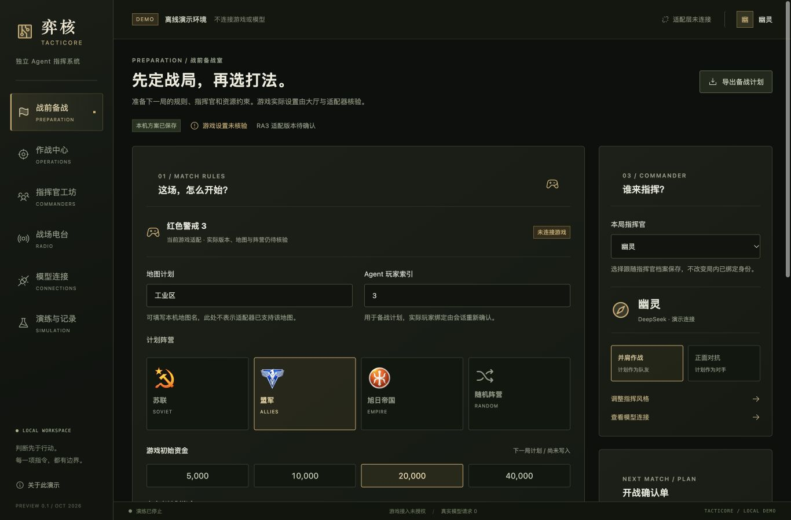
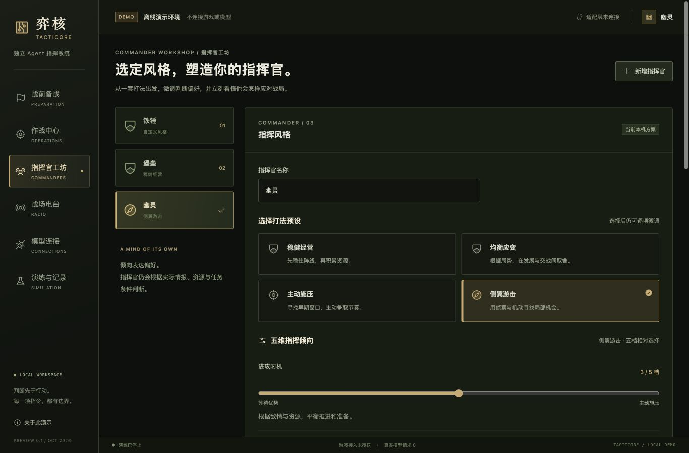
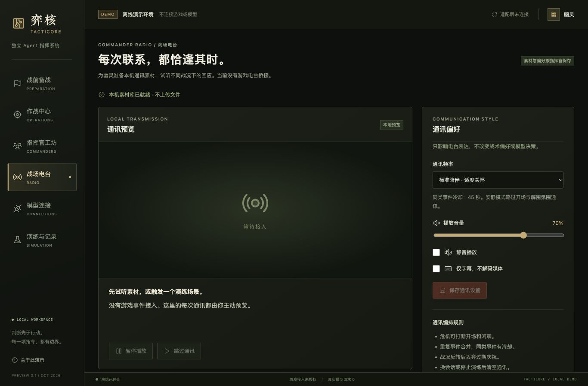

# 弈核 Tacticore

弈核是独立的 AI 指挥官程序，目前适配《红色警戒 3》。按用户最新明确的职责边界，模型根据己方可见战况与持续记忆，只判断进攻还是撤退、是否侦察、是否扩张，以及是否推进或暂缓建造和生产；具体建造操作、选址与顺序、兵种选择和数量、搭配协同及所有单位操作由原生电脑 AI 自主安排。用户可从 Windows 客户端配置指挥官、模型与风格，观察运行并停止指挥。

**2026-10-30 战略产品进展：** 默认模型目录、响应与派发均限制为高层意图，精确兵种/数量和逐建筑能力保留为历史研究。Native5试运行候选已接入十四项高层入口，覆盖原生扩张偏好、建设与生产调度门；真实模型联通、反馈进入后续判断、普通客户端停止与独立归还已有分项证据。本机固定范围已按F01–F07完成验收，临界容量测量差异已在后续源码修复，见[修复与验证说明](docs/commander-prompt-budget-fix-20261031.md)；实机专用事件来源及发布范围限制保留。完整结论见[战略指挥官验收报告](reports/strategic-final-acceptance-v9-20261030-v1/README.md)。工程约束见 [AGENTS.md](../AGENTS.md)，当前以 [最终验收清单](docs/commander-final-acceptance-strategic-20261029.md) 与 [产品集成进度](docs/commander-strategic-product-integration-20261029.md) 为准；下文冻结基线与历史证据保留原始范围。

项目名称不绑定 Remix。宣传网站、游戏 Mod 与本仓库分开维护；当前仍处于早期开发阶段。

**Windows v0.1-beta 发布开发已启动：** 先完成锁定依赖的独立 Python 阶段包与发布预检，再处理 Native 可迁移化、首次游戏接入和安装器。阶段包不具备游戏发布资格，旧 v9 三局也不替代新安装候选验收。见[发布执行清单](docs/windows-v0.1-beta-execution.md)及[阶段包构建说明](desktop-ui/README.md#windows-v01-beta-开发)。

Native6 已有独立的[可迁移离线候选](docs/windows-v0.1-beta-native6-offline-20261031.md)，完成实际编译、布局交叉核验及中文/空格目录搬迁；当前编译禁止附着游戏，普通客户端的准入、合法观测、Host/STOP 与恢复接入仍待完成。

## 当前状态 · 2026-10-30

下一阶段按新的战略指挥边界实施，不再以精确建筑或指定兵种数量作为验收门槛。十四入口已有真实分项证据索引，v9宿主意外结束后的只读归还、GUI停止与下一局解锁也已获独立复核。同一冻结v9、普通风格且无分时动作脚本的正式自然验收已通过 **3/3**（62660、103948、14092）。第二／四次104984、104244因结算尾链未知未计入，F01–F07本机工程范围总审已通过，三局属于v9历史版本，后续容量修复不改写这些原始记录。旧研究局、终局尾部unknown和失败记录保留，不补算正式。分项范围见[产品集成进度](docs/commander-strategic-product-integration-20261029.md)；以下 G0–G8 结论属于已冻结历史基线。

**本机固定场景的 G0–G8 及最终交付检查已通过。** 验收范围为《红色警戒 3》1.12、TemplePrime、P3 苏军、已资格化出生位置和逐项核验的原生宏观接口。完整结论见 [本机验收报告](docs/commander-macro-completion-20261028.md)，验收定义见 [宏观指挥目标](docs/commander-macro-goal-20261027.md)。

历史 schema9 通过了真实客户端及集结、撤退、增援专项闭环；其中完整自然对局证据复用已审的 schema7，模型辅助方告负。该批新增调度专项使用分时定向风格，不代表当前Native5候选已完成普通风格自主整局验证。基线和风格对照支持描述性比较，尚不能证明胜率提升。

`main` 提供源码、测试和文档。完整本机运行记录、生成包、脱敏时间线和原生录像另行归档，部分报告内的本机证据链接不随源码分发。当前尚未完成任意地图或阵营、跨机器安装、签名安装器与自动更新验收。

| 部分 | 已有能力 | 当前范围与限制 |
| --- | --- | --- |
| 模型与持续宿主 | 真实模型请求、持续记忆、结构化宏观计划、配置修订与权威命令账本 | 默认宏观模式；过期、旧局和不合法计划拒绝派发，未知结果不盲重发 |
| 经济与科技投入 | 模型选择预算优先级，原生账户采用及反馈进入后续决策 | 投入偏好不等于自由解锁科技，也不等于任意建筑可建 |
| 建设与生产 | Native5候选提供推进/暂缓原生调度门，具体建筑、顺序、兵种及数量由原生 AI 决定；两门暂缓后的STOP与原值归还已有实机独审 | 调度门不全局禁止开局或已提交工作；撤销额外意图回基线与显式推进入口分别验收，不能互相补数 |
| 扩张 | Native5候选已接原生扩张偏好，原生 AI 选择位置及方案；采用/等待/任务移动分层记录 | 偏好接收或任务移动不代表基地建成；旧精确建造、兵种数量研究不进入当前模型目录 |
| 侦察与区域调度 | 原生侦察、固定公开区域推进与改派、基础设施防守 | 目标选择和单位操作由原生 AI 完成；不开放任意坐标 |
| 集结、撤退与增援 | 各有真实模型意图、原生效果及后续真实反馈 | 效果按命令有效窗口核验，不保证全军到达、无损或每次成功 |
| Windows 客户端 | 已接本机连接配置、初始化、恢复、发现/预检、启动/观察/停止与诊断；普通GUI早期取消、已接管停止、诊断下载已有分项核验 | 接管前容量检查及未接管证明有独审；正式三局分项核验已齐，普通流程与既定异常恢复已通过本机范围总审，debug构建依赖本机开发环境 |
| 停止与复盘 | 停止记录提交后拒绝新准入，独立核验原生归还；实际下载生成的早停时间线已通过播放/跳转检查 | 已准入批次可能先完成，须等待停止生效及独立归还；原生 AI 可继续。同进程原生epoch停止后重接仍关闭，原生录像不保证重现外部宏观指令 |
| 风格与电台 | 原生客户端风格进入真实模型；浏览器演示提供本机媒体素材管理与试听 | 风格差异不等于胜负因果；电台尚未与真实局内事件联动 |

## 现在怎么用

本机已准备开发依赖时，从仓库根目录启动当前 Windows 开发预览：

```powershell
& '.\desktop-ui\src-tauri\target\debug\tacticore-desktop.exe'
```

可执行文件、Python源码、Native制品与游戏包应匹配本次冻结候选的版本清单。此前记录的 `168ebbad430c76cdd60c2b66bf3312737abd4e24bbceb0cc9657c6bf13cc57aa`／`index-DAJnEEyf.js` 属于旧隔离预览，不能确认后来重建的客户端。当前仍是依赖本机仓库与 Python 环境的 debug 预览，不是可直接分发的安装包。

按[玩家使用指引](docs/desktop-next/player-guide.md)完成初次配置或读取已有连接，再发现游戏、准备对局、检查、启动与观察；结束时请求停止并等待独立归还，随后准备新会话。普通流程不要求手改 `session.json`。本机运行组件、受信发现配置和匹配游戏包仍须预先备妥。

首用、保存、自动重载、重开及事务恢复在隔离业务库验证；另有普通客户端真实模型/原生试运行、早期取消及已接管停止、独立归还和真实诊断下载原件。二者范围分开记录。Native5记忆压缩曾触发预算异常，修订后的v9正式首局17轮实际请求守住1536字节策略子门及16KiB总门，旧故障保留。正式首局的自然结算、完整归还、诊断与可播放过程已有独立复核；第三次尝试103948也已完成单局核验，第五次14092亦已通过，正式 **3/3**，三路交叉复核已齐；按最新高层职责边界的F01–F07本机工程验收已完成。详见[玩家指引](docs/desktop-next/player-guide.md)与[产品集成进度](docs/commander-strategic-product-integration-20261029.md)。

历史v9保留接近16KiB边界时的本地容量拒绝记录；当前源码已修复准备／发送阶段示例选择不一致的问题，真实超限仍拒绝。修复回归与历史三局的范围见[说明](docs/commander-prompt-budget-fix-20261031.md)。确定伤亡／基地受袭的专用实机事件生产者亦未资格化，受控模拟判断与实际信息来源分开。详见[最终报告的已知限制](reports/strategic-final-acceptance-v9-20261030-v1/README.md)。

## 工作方式与工程亮点

弈核保留原生 AI 的单位操作能力，让模型聚焦跨轮的宏观选择。执行记录区分“模型提出”“校验通过”“原生接受”“观测到效果”和“后续决策收到反馈”，便于定位指挥是否真的生效。

```text
Windows 客户端：配置 / 预检 / 启动 / 观察 / 停止 / 诊断
                         ↓
合法己方观测 + 持续记忆 → 模型宏观计划 → 合同、身份与预算校验
         ↑                                      ↓
后续决策与客户端展示 ← 效果反馈与命令账本 ← 原生 AI 高层消费者
```

模型只获得受支持的能力目录与合法情报；提示词和动作名称本身不授予执行权限。请求保留 16KiB 输入边界，原生接受与实际效果分别记录。持续记忆、风格配置、效果回传与可审阅的时间线，构成后续自主战略和战后复盘的基础。

PydanticAI 负责有界模型请求、provider 和取消；策略合同、记忆、预算与执行授权由弈核维护。旧微操、近场攻击和逐枪实验保留为历史资料，不作为当前宏观模式的执行路线。具体职责见 [决策层 ADR](docs/agent-runtime/0001-pydantic-decision-runtime.md)。

## 界面预览

以下为 2026-10-25 的浏览器离线演示截图，用于展示备战、风格和电台的界面设计。当前 Windows 原生客户端使用独立的 `NativeApp` 入口，真实宿主能力以本页验收范围为准。

**战前备战室**：选择阵营、指挥官关系与开局资金计划，分别管理生产额度和资源保留底线，保存或导出方案。



<details>
<summary>展开指挥官工坊与战场电台截图</summary>

**指挥官工坊**：浏览器演示提供打法预设、五维五档倾向与行为说明；真实风格应用通过原生客户端完成。



**战场电台**：管理本机视频、音频和字幕素材，试听场景通讯并调整播放偏好。真实局内事件联动仍待实现。



</details>

## 下一阶段计划

按[战略最终验收清单](docs/commander-final-acceptance-strategic-20261029.md)继续实施。旧[功能完善计划](docs/commander-macro-next-stage-plan-20261028.md)保留历史范围；其中精确建筑、兵种数量和逐笔付款门槛不再作为本期目标。当前三条工作线为：

| 工作线 | 下一阶段重点 | 验收目标 |
| --- | --- | --- |
| 自主战略与持续调整 | 长期战略状态、保持与改派条件、无效果冷却、跨轮反馈 | 当前候选版以普通风格完成三局自然对战，不使用分时指令替模型选动作 |
| 完整客户端会话流程 | 受信游戏发现与注册、清晰状态、客户端重开恢复观察、故障与下一局流程 | 普通流程无需手改会话文件；同局停止后重新接入作为独立研究项 |
| 原生高层建设、生产与扩张 | 继续资格化Native5调度门与扩张偏好，逐入口补真实模型联通及反馈 | 原生 AI 自主选择具体方案；明确等待、已满足、采用与效果，不翻译为精确模板/数量命令 |

实机验证共享唯一游戏客户端，按依赖顺序串行安排；合同、实现与离线验证可并行。新地图、阵营、完整海空体系、局内电台和跨机器安装留待后续里程碑。

## 开发与文档入口

- [当前验收结论](docs/commander-macro-completion-20261028.md)：完成范围、版本边界、失败与交付限制。
- [下一阶段详细计划](docs/commander-macro-next-stage-plan-20261028.md)：三条工作线、任务拆分、依赖与验收。
- [宏观证据索引](docs/commander-macro-evidence-index-20261028.md)：按日期区分最终结论与历史阶段记录，原始证据部分仅本机保存。
- [桌面开发说明](desktop-ui/README.md)：浏览器与原生入口、构建、配置和受信登记机制；较早阶段记录需结合当前验收结论阅读。
- [Windows 验证交接](docs/windows-validation.md)、[模型运行时](agent_runtime/README.md)：依赖、开发环境与模型调用边界。
- [文档索引](docs/README.md)、[参考与归属](docs/references-and-attributions.md)：模块文档和依赖来源。

## 目录与职责

| 目录 | 职责 |
| --- | --- |
| `agent_runtime/` | 默认模型后端、统一 factory、版本锁和离线框架测试 |
| `strategy/` | 宏观策略合同、严格解析、持续记忆、计划生命周期和输入预算 |
| `integration/` | `macro_host.py`、宿主服务、可信会话绑定、配置修订、账本与反馈 |
| `desktop-ui/` | React + Tauri 客户端、受限 Rust RPC、浏览器离线演示与本机媒体管理 |
| `native-ai/` | 原生宏观消费者、传输、合法观测和资格核验工具 |
| `visibility/` | 己方视角敌情、最后目击和视野过滤 |
| `production/`、`tactical/` | 可复用适配与历史生产、战术实验；当前执行权限由宏观能力包决定 |
| `benchmark/` | 原生、固定策略与模型贡献统计、风格对照 |
| `acceptance/`、`reports/` | 验收工具、测试和证据记录；本机运行产物不完整随源码分发 |
| `docs/` | 当前结论、实施计划、架构合同、验证说明与历史归档 |

## 本地开发

### Python 与模型运行时

需要 Python 3.12+。从仓库根目录创建环境并安装固定依赖：

```powershell
py -3.12 -m venv .venv
$tacticorePython = (Resolve-Path '.\.venv\Scripts\python.exe').Path
.\agent_runtime\Install-Windows.ps1 -Python $tacticorePython
```

安装脚本运行模型运行时离线测试及 `pip check`，不会启动游戏或请求真实模型。后续命令继续使用同一虚拟环境；Windows 回归建议加 `-X utf8 -B`。部分策略、宿主和验收测试直接重放本机历史证据，新克隆未包含这些材料，不能直接复现完整本机回归。

真实游戏开发另需 RA3 1.12 x86、匹配的宏观包与能力证据，以及 x86 C++ 工具链；部分打包工具还依赖 RA3 SDK。下载工具链和研究参考目录不随仓库提供。根 `Build.ps1` 是原生桥接构建入口；宏观运行时有独立构建脚本，不能用旧桥接构建代替当前能力核验。

### 浏览器离线预览

需要 Node.js 22.22+：

```powershell
Set-Location desktop-ui
npm ci
npm test
npm run dev
```

打开 `http://127.0.0.1:5174/`。浏览器入口展示六个工作区，不调用真实模型、不读取游戏，也不需要 API Key。`npm run build` 检查 TypeScript 和静态前端构建。

### Windows 原生客户端

另需 Rust MSVC 稳定工具链、Visual Studio 2022 C++ Build Tools、Windows SDK 和 WebView2。在已准备 Python 与前端依赖的环境中，从 `desktop-ui/` 执行：

```powershell
.\scripts\build-windows.ps1
.\scripts\build-windows.ps1 -NativeTests
```

Debug 输出为 `desktop-ui/src-tauri/target/debug/tacticore-desktop.exe`，使用原生 `NativeApp` 与仓库 Python 宿主。Release 需要独立 companion、逐文件清单与编译进 Rust 的完整性摘要；构建窗口成功不授予游戏执行资格。初次连接配置可在窗口内初始化；已有连接可通过可信配置通道修改和恢复。受信运行组件、发现配置及宏观 bundle 仍需按 [桌面开发说明](desktop-ui/README.md)准备，当前源码不是开箱即用安装包。

## 配置与数据

真实宿主默认使用 `%LOCALAPPDATA%/Tacticore/library.v2.json` 中的指挥官与受保护模型连接；模型 CLI 可显式指定 `--library`。原生客户端经可信登记引用配置库，在 `%LOCALAPPDATA%/Tacticore/desktop-runtime` 独立保存风格修订与运行状态。风格保存与连接配置使用不同的受限接口；连接更新须在已停止且独立归还后进行，保存成功使旧预检失效。修改提供方或接口时须重新输入密钥或停用已保存密钥。保存风格、宿主应用、模型消费和实际效果分别核验。Windows DPAPI 与连接格式见 [模型服务说明](strategy/HTTP_SERVICE.md)。

浏览器演示的草稿使用 localStorage，媒体使用 IndexedDB，与原生 ProfileStore 相互独立，不会自动迁移。电台素材保存在当前环境，不上传远端；单条媒体上限 32 MiB / 90 秒，每位指挥官最多 24 条自定义素材、合计 128 MiB。

游戏初始资金、生产总支出上限和资源保留底线分别管理。浏览器备战方案的保存或导出不等于游戏生效；`--total-budget` 与 `--reserve` 不设置游戏初始资金。真实运行只采用已经过预检、获得对应资格的配置与动作。

密钥、DPAPI 文件、本机连接库、模型流量、运行锁、生成包、编译产物与下载工具链不纳入源码提交。会话、源码、适配包或能力证据失效时应拒绝执行，不能改写历史证据使检查通过。

## 验证记录与已知限制

2026-10-28 本机冻结版本的回归结果为：策略 255、宏观 117、宿主 456、前端 56 项通过；提交前另验证角色、总评估、打包和续接预检工具共 60 项通过。这些是对应版本与本机输入的结果，不代表所有平台或新克隆环境都能复现。

完整自然局有 58 次真实模型响应、52 次派发和 30 轮先前策略记忆，结果为模型辅助方败。当前 schema9 的专项局另有 12 次真实响应和 11 次原生派发，不能将它冒充新的完整自然局。构建、证据来源及详细失败见 [最终验收结论](docs/commander-macro-completion-20261028.md)。

当前的重点限制包括：支持范围固定，Native5建设/生产调度门与高层扩张已按固定场景通过战略意图验收，正式三局及既定客户端流程已完成本机范围验收，同进程停止后不可重新接入；原生录像对外部宏观指令的保真和跨机器安装也未通过。本期以高层意图闭环与普通用户流程推进，不恢复精确模板或队列数量作为必过门槛。

## 参考、借鉴与依赖工程

下表区分研究参考、实际技术依赖与素材来源。引用不表示上游项目、游戏厂商或 Remix 作者参与开发、授权合作或为弈核的能力背书；各项目及素材保留各自的权利与许可。

| 工程 / 来源 | 关系 | 在弈核中的具体用途 |
| --- | --- | --- |
| [Ra3-Copilot](https://github.com/ProbiusOfficial/Ra3-Copilot) | 接口研究参考与局部工具 / 数据复用 | 历史参考提交为 [`2d31f7c`](https://github.com/ProbiusOfficial/Ra3-Copilot/tree/2d31f7cc0ce47e257a5ecb95cc4f44a8b26f8015)。公开偏移、接口入口用于研究假设和结构命名；部分辅助脚本实际加载其 `sage_hash.py`、`battle_catalog.h` 或研究工具。未编译或加载整个上游修改器；局部复用范围见详细归属记录 |
| [MinHook](https://github.com/TsudaKageyu/minhook) | 实际原生组件依赖 | 多个原生构建脚本从 Ra3-Copilot 参考目录取用 MinHook 1.3.3 源码并编译到实验组件中；部分脚本复制其许可文件，构建和分发须保留相应声明 |
| [pySAGE / sage_apt](https://github.com/ClementJ18/pySAGE) | 实际离线解析工具依赖 | `native-ai/decompile_frontend.py` 导入 `sage_apt.aptfile`，用于前端 APT 的离线解析 / 转换；不代表弈核运行了其 viewer 或 server |
| [w64devkit](https://github.com/skeeto/w64devkit) | 实际构建工具链 | 用于 Windows x86 原生桥接与实验程序构建；历史使用的版本和下载哈希留存在开发记录，完整工具链不随本仓库分发 |
| [PydanticAI](https://github.com/pydantic/pydantic-ai) | 实际模型运行依赖 | 默认通过 `pydantic-ai-slim[openai]` 管理一次有界模型请求；当前固定版本为 2.61.0，策略合同、记忆与执行权仍由弈核模块负责 |
| [React](https://github.com/facebook/react)、[Vite](https://github.com/vitejs/vite)、[Tauri](https://github.com/tauri-apps/tauri) | 实际桌面技术依赖 | 分别用于界面组件、前端开发 / 构建和原生桌面外壳；实际版本以 `package-lock.json`、`Cargo.lock` 为准 |
| [Phosphor Icons](https://github.com/phosphor-icons/react) | 实际图标依赖与图标衍生 | 界面图标及 Circuitry 衍生应用图标；原 MIT 许可原文见 [桌面第三方说明](desktop-ui/THIRD_PARTY_NOTICES.md) |
| RA3 / Remix-Ai 宣传站的阵营参考素材 | 游戏主题与用户提供参考 | 备战室复用宣传站既有阵营图；它们不属于 Phosphor 的 MIT 许可范围，也不表示获得游戏或 Mod 的整体授权 |

游戏、SDK、RA3 阵营标识及相关资料的权利归 Electronic Arts 和相应权利人；Remix 原创 Mod 内容归对应作者与权利人。本仓库不包含游戏本体、第三方完整修改器或完整工具链。以上依赖各自的许可证不能解释为本仓库整体采用同一许可证。更完整的来源、使用范围和许可说明见 [参考与归属记录](docs/references-and-attributions.md)。

本项目仅用于学习、研究与交流，不开展商业化或盈利活动；此用途声明不改变第三方作品各自的权利归属。

## 历史开发记录

早期移动原型、私有机器环境、旧客户端与工具版本记录已迁至 [README 历史归档](docs/history/readme-development-records.md)。当前开发优先参考本页、带日期的验收记录和 Windows 交接，不按归档中的“后续优先级”执行。
