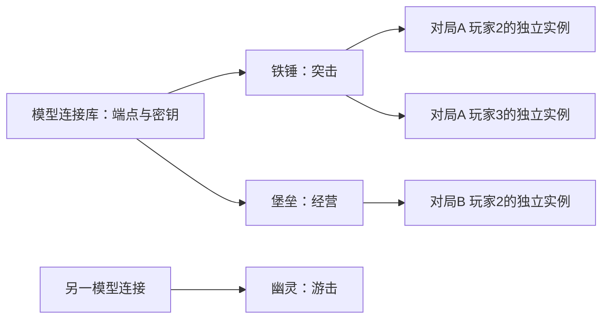

# 多指挥官产品约定

## 用户流程

1. 在“模型连接”里添加连接：连接名称、供应商、基础地址、默认模型、密钥与本机保存选项。
2. 在“指挥官档案”里创建有名字的角色：选择连接、继承或覆盖模型、选择性格、编辑偏好。
3. 保存本地档案，导出不含密钥的游戏登记清单。未完成登记时显示“待游戏注册”。
4. 未来游戏遭遇战按名字选择角色；桥接识别角色ID及玩家槽位，为每个电脑玩家创建独立指挥实例。
5. 模型、游戏回调、人格绑定与战略执行器均通过后，才可开始真实指挥。

## 关系和边界

示例名字只代表预设角色，不意味着模型或游戏已连接。

- connection_id：连接的稳定身份；改连接名字不换ID。一个连接供多个档案复用，密钥不复制到档案。
- commander_id：角色稳定身份；改名字或性格不换ID。供应商、端点与密钥由连接引用解析。
- instance key：session_id + player_id + commander_id。即使同一角色同时控制两个电脑玩家，战场记忆、当前计划、超时与反馈也必须隔离。
- 模型默认值由连接提供，角色覆盖必须显式显示；不能因为连接切换而悄悄把旧密钥发给新端点。
- 被档案引用的连接不能静默删除或转移；先明确解除引用。
- 当前产品要求指挥官显示名唯一，便于列表选择；绑定始终使用稳定ID，名字进入XML或本地化容器前正确转义。
- 改档案后，本地保存、导出登记、游戏已加载三个版本分别可见；运行中的对局不能误报自动更新。

## 状态文案

| 状态 | 准确含义 |
| --- | --- |
| 本地已保存 | 配置持久化成功 |
| 模型验证通过 | 本次测试响应有效，不保证未来网络可用 |
| 待游戏注册 | 已有档案，但游戏内尚未确认可选 |
| 游戏回调通过 | 只证明实验桥接回调可达 |
| 已绑定玩家 | 已核对会话、电脑玩家与人格ID |
| 战略执行器就绪 | 已通过真实队列、花费、出厂验证 |
| 离线演练 | 用样本和模拟适配器，不控制游戏 |

## 本轮视觉要求

沿用现有红黑金属和金色边框。连接、角色、战局分区有清楚标题；列表、下拉项、选择态、焦点态都使用同一套深色控件。减少每个页面重复输入端点和密钥。真实功能未验收时，解释缺少条件并禁用入口，不伪装成功。

当前游戏登记和持续接管仍未通过；此文档是实施约定，不能替代行为验收。
