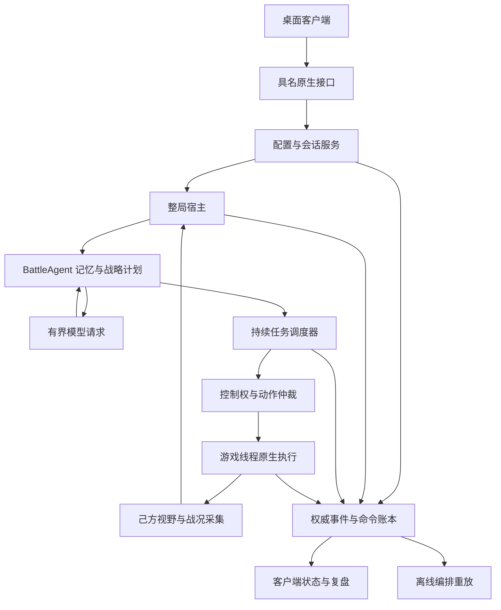

# 弈核架构建设与迭代计划

日期：2026-10-26。状态：用户已授权按本计划持续实施，已建立独立总目标和分阶段目标。旧实机试错线保持停止；新架构按阶段门开发和验证，当前进度见 [实施状态](architecture-implementation-status.md)。

## 一、建设目标和当前决定

最终目标是：用户从当前 React/Tauri 客户端选择一名指挥官、模型连接和风格配置；宿主明确接收本局配置，让模型通过已经验证的能力控制己方行动，与真实原生电脑完成一整局；全部配置、决策、执行、效果和结算都有可追溯记录。

建设采用分层演进：保留已验证的桥接、视野、游戏线程执行、持续记忆和证据校验；重新划分配置、整局宿主、任务调度、控制权仲裁与校准实验的职责。原主攻、经济骚扰、兵种协同的真实效果和回撤要求保留，不能用客户端起局或单局胜利替代。

旧线停止状态：旧主目标在本机记录中为 blocked，原接续目标保持 paused；MF18 控制器和生产器已有终态与释放记录，遗留轨迹记录器已正常退出。用户随后已明确授权新架构多 Agent 开发及所需验证。独立总目标为 `01a17637-7de8-7813-b68a-bfeaccb3faab`，不再等待旧目标完成，也不恢复按旧 MF 编号整局试错。

基线依据：[独立架构审查](../strategy/reviews/architecture-iteration-audit-20261026.md) 与 [复现证据](../strategy/reviews/architecture-iteration-audit-20261026-evidence.json)。下述为目标设计，只有在实施状态中列出验证证据的部分才算已实现。

## 二、先明确产品究竟控制什么

第一阶段采用明确的“原生 AI 辅助指挥”模式：原生 AI 继续承担当前未接管的经营和作战；模型通过受控生产和具名小队任务产生可归因的额外行动。客户端和报告必须显示这个模式，不能称为模型独立接管全局。

完整接管经济、科技和全部军队是另一组能力建设，需要原生执行接口和独立验证。当前全部指挥官继承 Balanced 经营模板，修改 personality 或提示词不会自动改变这部分原生逻辑。

| 需求 | 当前事实 | 本计划的完成标准 |
| --- | --- | --- |
| 风格预设、五维五档和补充偏好 | 客户端生成本地草案；宿主尚未消费该草案 | 配置修订被宿主接受，最终有效偏好进入真实请求，并关联本局任务回执 |
| 经济与科技风格 | 模型字段存在，未找到相应真实建造执行器 | 明确能力缺口；实现相应动作后才能宣称该维度影响经济或科技，不能静默忽略 |
| 模型反复指挥部队 | 当前付费双兵控制器一次准备后不再运行 | 同一局完成任务 A、归还、再分配任务 B，重复执行不串控制权和资源 |
| 与原生电脑打一整局 | 有历史整局，但新模型/客户端/高级战术未整体通过 | 当前发布包、真实配置、新客户端启动到自然结算，双方身份独立核验 |
| 日志与过程 | 有大量原始记录，关键选择和提交路径仍有空白 | 从配置到结算可按统一 ID 还原每次接受、拒绝、执行、效果及未知结果 |

产品基础闭环和三类高级战术分别记里程碑。基础闭环可证明配置应用和宿主生命周期；原完整目标只有三类任务真实效果及完整对局均通过后才完成。此拆分用于诊断和交付管理，不把未实现能力从总目标中删除。

## 三、目标架构和职责边界



| 模块 | 唯一职责 | 主要输入和输出 | 禁止承担的职责 |
| --- | --- | --- | --- |
| 客户端 | 编辑配置、展示权威状态、发起具名操作 | profile/revision、requestId；状态与回执 | 自行判定执行成功、直接访问游戏地址或执行任意命令 |
| 配置与会话服务 | 身份映射、配置版本、凭据引用、预检和本局绑定 | UI 草稿 → EffectiveProfile、SessionBinding | 从 UI 状态推导执行权限 |
| 整局宿主 | 启停、采集、模型调度、任务反馈、故障恢复 | 可见事实、模型计划、权威账本 | 复制另一份模型长期记忆或隐式反复重试 |
| BattleAgent | 持续记忆、意图、资源预留和任务计划 | 有期限事实与回执 → 受约束计划 | 直接调用游戏函数、越过能力目录授权 |
| 模型运行层 | 一次有界请求、取消、超时和结构化输出 | 冻结请求上下文 → 输出或固定错误码 | 持有单位租约、逐帧寻路或决定恢复是否成功 |
| 任务调度器 | 编队分配、任务生命周期、进度与撤退 | 接受的任务 → 有序命令与终态 | 以一次成功探针替代持续生命周期 |
| 动作仲裁器 | 每个演员的归属与命令优先级 | 任务、允许的原生行为、人工/停止请求 | 无条件吞掉未知命令或把全部原生行为当作抢控 |
| 原生执行层 | 在已验证线程执行有限命令、反馈事实 | 有效绑定和命令 → 原始回执 | 发网络请求、在游戏线程等待模型或磁盘操作 |
| 事件账本与重放 | 命令意图、回执、事实、关联、重放 | 所有关键转移 → 审阅材料和复盘 | 把回执不足的未知结果补成成功 |

继续使用当前 PydanticAI 单请求边界；不因为本次审查而更换 Agent 框架。先修业务边界、调度和可观测性。

## 四、配置到实际行为的合同

配置分为 MatchRules、CommanderPreferences、ExecutionLimits、CommunicationPreferences、ModelConnection 五组。比赛初始资金、生产支出上限和保留资源分别存储、分别核验。软风格不能放宽硬资源或视野限制。

建议引入以下版本化对象，具体字段在阶段 G1 冻结：

- `ProfileDraft`：用户编辑内容，含 profileId、revision、五维五档、预设、补充偏好和连接引用。
- `EffectiveProfile`：规范化后的 personality、完整偏好文本、结构化偏好、支持状态、提示词预算和内容 hash。
- `ProfileApplication`：接受/拒绝回执，绑定 profileRevision、effectiveHash、sessionId、hostIdentity、requestId 和原因。
- `DecisionEnvelope`：请求/响应 ID、应用的配置修订、观察快照、能力版本、有效期和接受结果。

本局状态明确区分“草稿、已保存、宿主已接受、已进入真实请求、已产生对应行为证据”。改变运行中不可修改的配置只保存为下一局；允许热改的字段也必须收到新修订回执后才显示应用。

### 五个风格维度的真实映射

| 维度 | 可观测的预期行为 | 所需能力 | 验收方式 |
| --- | --- | --- | --- |
| 进攻时机 | 合法机会出现后更早或更晚提交进攻，保留必要防守 | 机会评估、进攻任务和调度 | 同一记录输入下比较任务选择/等待原因，再检查实战回执 |
| 风险承受 | 在统一安全底线内改变投入及提前撤退偏好 | 威胁评估、损失观测和本地撤退 | 固定风险序列下验证触发与执行；不得越过不可放宽的安全边界 |
| 经济投入 | 在可执行经济动作和军费间真实选择 | 经济建造/扩张执行器及资源账本 | 分开的经济与军费支出、建筑/经济效果；当前缺口必须显式展示 |
| 侦察积极 | 在允许单位和可达区域安排侦察，更新己方可见事实 | 合格侦察执行器和视野反馈 | 侦察任务回执、信息更新时间；不使用全图情报验证成功 |
| 追击尺度 | 达成目标后继续、停止或撤退，受视野/接应约束 | 持续任务、目标记忆与回撤 | 固定目标/视野变化输入及实际任务阶段记录 |

现有“经济/军队/科技相加成为同一兵种生产额度”的投影要改为类型明确的预算与动作；未实现经济或科技动作时，输出必须产生明确的 unsupported/advisory 回执。不能通过把文案改成“偏好”就宣称完整风格已经实现。

当前 traits 会按 1200 UTF-8 字节截断。新合同先计算有效字节预算，再组合预设摘要、五维解释和用户文本；若放不下，必须明确指出未应用内容或要求缩短，不静默裁去用户末尾偏好。实际请求日志记录有效文本 hash、字节数和截断状态，凭据不进入日志。

## 五、可重复的任务和控制权模型

### 任务生命周期

```text
Proposed → Validating → Planning → Preparing → Ready
          → Committing → Accepted → Executing
          → Returning → Released → Completed / Failed / Cancelled
```

每个拒绝阶段都有固定原因码。`Uncertain` 单独表达请求可能已交付而回执缺失的状态；不得自动重发可能已执行的命令。目标完成、实际回家和控制恢复是三项独立事实。

规划尽量先于不可逆的资源消费和借兵。可先准备当前可见候选及计划意图，待角色真实就绪后再做最终身份、视野、路线、期限和能力复核。预检看到目标不构成未来的攻击授权。

新生产单位如何进入待命队伍，必须先做受控实验确定：优先比较“生产前已知意图、出厂时有界接管”和“原生池中按需借用”。若需要持有待命单位，该阶段也必须受总持有期限、资源占用和明确释放条件约束，不能借改名把短租约变成无限持有。

### 三类时间

| 时间 | 用途 | 暂停与超时处理 |
| --- | --- | --- |
| 模拟帧 | 单位任务、证据新鲜度、移动与战斗阶段 | 以游戏实际帧推进，不通过重规划重置总期限 |
| 单调墙钟 | 模型请求、IPC、进程和无响应保护 | 游戏暂停也继续，超时产生明确拒绝或未知状态 |
| 观察年龄 | 请求使用的视野、演员和能力快照 | 提交前重新验证，超期拒绝并记录具体字段 |

准备、模型等待、提交、执行和撤退分别计时，同时保留首次持有起算的硬上限。所有新窗口必须有解释和覆盖测试；不能只把 450 帧继续加大，也不能靠暂停游戏规避期限。

### 动作仲裁

每个演员最多有一个有效任务所有者，绑定 session、actorId、出生/代际标识、leaseId 和角色。命令分为当前任务主命令、经验证允许的原生微操、需要让出控制权的战略改派、停止/异常。

原生让路与自卫按已验证语义处理。未知命令保留原始参数和调用来源，在限定时间内中止并安全释放；不直接给未经验证的白名单权限。人工停止和身份变化必须优先于模型后续计划。允许原生自卫时仍要明确伤害归属和目标来源，不把其效果归给模型攻击命令。

## 六、持久化、日志和恢复

拟采用本机 SQLite WAL 保存唯一权威的 commands、events、profile_applications 和 session_bindings；JSONL、状态 JSON 和客户端视图是可重建导出。不得同时把数据库与 JSONL 当成两套可互相覆盖的权威状态。已有原始证据保留，并由适配层读取。

发送游戏命令前持久化 intent；回执到达后记录 accepted/started/effect/released。跨进程重启先查账本及原生当前状态，不假定“最后一次没收到回执”就是没执行。不能承诺数据库事务使外部游戏动作 exactly-once；采用幂等请求、有限派发和未知结果核对。

统一关联字段至少包括 runId、sessionId、gameProcessIdentity、hostIdentity、profileId/revision、requestId、decisionId、planId/generation、taskId、leaseId、actorId/generation、gameFrame、monotonicTime、eventType、reasonCode 和 source。

每轮必须记录 candidate→plan→ready→validated→published→accepted 的阶段耗时；目标筛选要记录候选数、各过滤原因、当前可见来源与年龄、ready 剩余帧。事件丢失或原生日志溢出必须显式报告，缺数据不能补造。

凭据只保留受保护的引用，不写命令行、WebView 存储、截图或诊断包。不记录隐藏推理过程；模型审阅材料采用任务相关输入/输出摘要、有效偏好 hash 和结构化结果。

## 七、客户端接线和现有功能对齐

新增具名原生操作，建议为 `profiles.list/save/apply`、`session.inspect`、`run.check/start/status/stop`、`events.subscribe`、`diagnostics.export`。接口只接受稳定 ID 和修订，不接受任意路径、命令字符串或内存地址。

| 工作区 | 必须接通的真实数据 | 不支持时的行为 |
| --- | --- | --- |
| 战前备战 | 实际阵营/槽位/地图、资金读回、支出上限和保留底线 | 引导在大厅设置并核验；无法读取就显示无法核验 |
| 指挥官工坊 | 档案修订、有效风格、宿主接受和模型消费状态 | 逐维显示不可执行/仅建议，不显示全部已生效 |
| 模型连接 | 连接引用、模型覆盖、凭据存在性、受控连通检查 | 固定错误原因与重试入口，密钥由原生端保护 |
| 作战中心 | 真实宿主状态、意图、任务阶段、执行与效果回执 | 断线显示最后观察时间，结果未知时禁止重复启动 |
| 演练与记录 | 本局时间线、配置快照、原始证据索引与自然结算 | 演示记录和真实记录分开，缺口如实列出 |
| 战场电台 | 已验证的真实事件、当前会话的媒体调度与字幕 | 无事件接线时保留本地试听状态，不能称为实战触发 |

沿用现有 Windows 交接合同的请求去重、配置修改后预检失效、短期就绪令牌、停止确认和断线恢复要求。关窗口、停止观察、取消模型、停止宿主和结束游戏是不同操作。

## 八、按阶段门推进的建设顺序

### G0 停止旧线并保存基线

交付：记录目标状态、进程状态和实际停止回执；保存当前源码、构建输入、原始失败和审查报告。旧 MF 目录作为历史实验保留。

通过条件：没有旧线活动命令或后台采样；存在可追溯的归还/释放或明确未知状态。未知不得以强杀游戏掩盖。本次已核对旧目标状态并停止遗留记录器；完整原始冻结资料仍按现有证据保留。

### G1 冻结能力与控制契约

工作：逐项梳理 UI 字段与真实消费者；形成能力目录、五维映射、控制模式、预算语义、身份/代际与动作归属合同。对未支持字段形成固定回执。

交付：能力矩阵、配置/会话/任务 schema、原生动作权限表、旧接口到新接口的迁移表。

通过条件：每个对外可编辑字段都有消费者和验证证据要求；经济/科技不会再静默合并成兵种额度。若尚缺执行能力，明确计入未完成项。

### G2 建立观测与完整编排重放

工作：把目标选择和驱动器编排提取为依赖注入的纯决策部分；注入生产回执、FOV、演员就绪、虚拟模拟帧/墙钟与原生命令回执。补齐选择/提交日志。

必须覆盖：等待无目标不借兵、机会消失、生产拒绝、出厂过渡、迟到模型结果、合法候选按时提交、commit 拒绝、命令结果未知、换局和停止。已有 MF18 缺少逐次 selector 输入，只能重放现有可证部分；新采样补足后才能完整重现。

通过条件：每个分支有可解释的终态和原因；同一输入与时钟产生相同命令序列；不依赖真实游戏启动才能发现编排错误。

### G3 构建可重复宿主与权威账本

工作：将固定 UUID/player/map 移到验收场景配置；清理一次性 attempted 生命周期，建立任务注册表、编队资源池、事件账本和能力查询。通过适配层继续使用已验证原生执行器。

通过条件：同一会话任务 A→释放→任务 B；重复 requestId 不重复派单；相同 ID 不同内容被拒；宿主崩溃/响应丢失进入核对而不是盲重发。基础验证先使用模拟 transport 和已验证范围。

### G4 校正原生控制权与近场闭环

工作顺序：单演员 Move/Hold/Return → 让路/自卫/非法改派的分项实验 → 一兵近场可归因命中和撤回 → 双兵近场任务和双回撤 → 当前视野丢失/停止/死亡处置。

通过条件：每次实验进入预定分支，真实运动、命中、物理回家和恢复分别有证据。新近场能力只能授予对应范围，不能自动解锁公里级任务。

实验每次只改变一个主要因素；同一阻断连续两轮未触达待测分支就返回 G2/G1，不再通过复制大版本继续尝试。

### G5 打通真实配置与客户端基础闭环

依赖：G1、G2、G3。原生 IPC 与配置验证的离线部分可在 G4 研究期间独立推进；真实执行只使用当时已授权能力。

工作：档案 UUID 映射和版本转换、受保护凭据引用、EffectiveProfile、应用回执、预检、开始、观察、停止、日志导出。接通四预设和五维五档的支持状态；处理提示词字节预算与运行中/下一局配置。

通过条件：从真实客户端启动已支持动作，日志可证明同一配置修订进入模型并对应本局任务；停止得到权威确认；重复开始、旧令牌、断线和换局均不产生误派发。

此阶段允许形成明确标注范围的基础里程碑。未支持的风格维度和高级战术仍列为未完成，不能将本阶段标为原完整目标完成。

### G6 扩展战术与缺失的宏观动作

工作：在稳定合同上逐项扩展长程接近、威胁路线、持续交战、经济骚扰、兵种角色协同、侦察；同时为经济/科技风格需要的建造和扩张能力做接口探索、实现与验证。

每项先有可控输入与重放，再有局部实机，再有整局使用。原生寻路负责已支持的移动细节；战略层决定是否值得走这条路线。路线风险需要己方可见威胁、过期信息和退路观测，不用固定 HP 阈值代替全部战术判断。

通过条件：原主攻/骚扰/协同范围各自满足真实效果、任务接续、物理撤回与恢复要求；已宣布可执行的经济/科技/侦察偏好具有实际动作和证据。未知逆向接口先形成有结论的探索记录，不承诺靠改提示词完成。

### G7 从客户端完成正式对局和过程交付

依赖：G4、G5，以及本次正式场声明要启用的 G6 能力。原完整目标仍要求三类战术真实授权齐备。

工作：一名具名模型 AI 对一名真实原生电脑；使用新会话，优先沿原双方中等/10000/固定地图场景；实际大厅参数读回或独立核验。模型自动决定任务，不混入校准派单。持续运行至自然结算。

通过条件：配置应用证据、真实模型请求、资源花费、三类任务效果、记忆跨轮接续、控制归还和自然结算都有本局记录。胜负如实交付，不以必须赢作为生命周期验收。比赛中没出现的异常分支仍显示未覆盖。

交付：开始、关键交战和结算截图；条件允许的游戏回放/录屏；脱敏日志包、配置快照、完整时间线、失败/拒绝清单、任务统计、原生结算证明及可点击证据索引。

### G8 验证风格差异与模型贡献

工作：沿仓库 benchmark 规则比较原生基线、脚本任务和模型任务；对极端风格做重复场次或记录输入对照。没有可靠种子接口时如实标记随机性，不把重开两局视为同一轨迹。

通过条件：能区分配置已应用、模型选择发生差异、执行行为出现差异和胜负统计差异。样本不足时保持结论有限，不以一局胜利宣传模型优势。

## 九、工作包、依赖与交付管理

| 工作包 | 依赖 | 交付物 | 审阅重点 |
| --- | --- | --- | --- |
| 契约与能力目录 | G0 | schema、能力矩阵、配置消费者表 | 每个产品承诺是否可执行 |
| 事件与重放 | G1 | 事件规范、驱动器回放、分支报告 | 是否能解释未提交和超时 |
| 宿主生命周期 | G1/G2 | 参数化宿主、资源池、账本 | 第二次任务、幂等与未知结果 |
| 原生动作与仲裁 | G1/G2 | 允许动作合同、局部实机包 | 避让/自卫/改派和安全释放 |
| 桌面配置与 IPC | G1/G3 | EffectiveProfile、应用回执、真实 provider | 用户设置是否到达当前会话 |
| 战术/宏观扩展 | G3/G4 | 逐项版本化执行能力与证据 | 完整任务与五维实际能力 |
| 正式对局与复盘 | G5/G6 | 当前客户端完整对局证据包 | 身份、配置、效果、结算同源 |

先完成契约与重放的小批次，再按验证结果估算原生扩展工作量。逆向接口的未知性使固定日期承诺不可靠，计划用退出条件控制投入：每批只解决一个可验证问题，给出通过/失败/未覆盖/未知结论，再排下一批。

建议第一批实际实施仅包括：能力消费者表、完整 selector/commit 日志、可注入双时钟的编排重放、两份不同策略投影相同问题的合同修正方案。第一批交付后再安排原生实机，不继续整场碰运气。

## 十、代码组织、迁移和发布

保留 `desktop-ui/`、`agent_runtime/`、`strategy/` 的基本角色。建议在 `integration/host_runtime/` 内逐步形成 contracts、profiles、sessions、scheduler、arbitration、journal、replay 等模块；`integration/battle_host.py` 成为组合入口。该目录是提议，实施时按实际 import 边界调整。

旧 `acceptance/calibration/` 是实验 harness，不能成为产品唯一入口；它通过同一公开合同调用宿主。`tactical/mission-formation-v*` 的旧快照保持不可变，新活动实现按能力和协议版本演进，避免每次小修复制整个系统。

迁移采用适配器逐层替换：先事件与合同，再任务宿主，最后原生执行。新旧实现不会同时持有同一演员或同一 session/player 执行锁。每次发布绑定源码、DLL、协议、能力和证据清单；Windows 行尾/字节差异不能通过跳过 SHA 处理。历史证据使用其不可变包复验，不能追绑活动源码后改写旧结论。

## 十一、风险、恢复和停止条件

| 风险 | 处理方式 | 必须停止的条件 |
| --- | --- | --- |
| 未知原生命令或演员身份变化 | 保留原始信息，按合同中止并释放 | 无法证明当前控制归属 |
| 模型响应迟到或配置已变 | 拒绝过期输出，保留仍有效任务 | 旧输出企图覆盖新会话/新修订 |
| 命令已发但回执丢失 | 标记未知，查询权威原生状态 | 不能确认是否已经执行时禁止重发 |
| 原生日志溢出或缺帧 | 记录证据不完整 | 关键效果/恢复无法复核 |
| 经济/科技接口不支持 | 不授予执行能力，明确待建设 | 产品要求真实效果却仅有提示词变化 |
| 同一故障反复出现 | 返回可重放输入与控制合同 | 两轮未触达待测分支仍准备新大版本 |
| 停止请求无法确认 | 保持 stopping/unknown 并收集证据 | 不得显示“已停止”或创建新执行宿主 |

回滚只回到有真实证据的能力范围；回滚不修改失败原件，也不把控制释放等同于目标完成。需要结束游戏的操作与停止指挥分开处理。

## 十二、最终完成清单

- [ ] 客户端当前配置有修订、宿主接受回执和真实模型消费证据。
- [ ] 四个预设、五维五档和补充偏好逐项标明支持程度；声称生效的维度具有对应真实动作或明确可验证语义。
- [ ] 不再静默丢弃经济/科技策略或混淆预算。
- [ ] 同一局能反复创建、执行、撤回和归还任务。
- [ ] 原主攻、经济骚扰、兵种协同各有合格真实效果和任务恢复证据。
- [ ] 从当前客户端预检、开始、观察、停止和自然结算的生命周期闭合。
- [ ] 一名 AI 对真实原生电脑完整对局，身份与实际参数可核验。
- [ ] 过程日志、截图、可用回放和结果报告有统一关联和证据索引。
- [ ] 模型贡献与原生 AI 行为分开报告；未知和未覆盖不写成通过。
- [ ] 历史失败、冻结源码和原始记录保持可追溯。

以上清单全部满足后才能宣布完整目标完成。当前已开始新架构实施，阶段交付不替代总目标；旧实机试错线保持停止。
